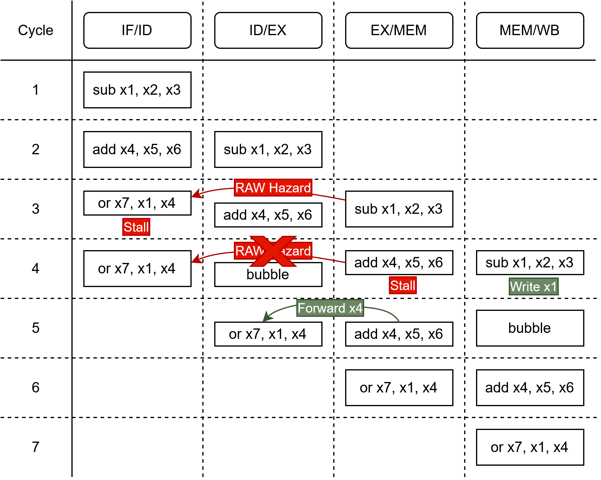
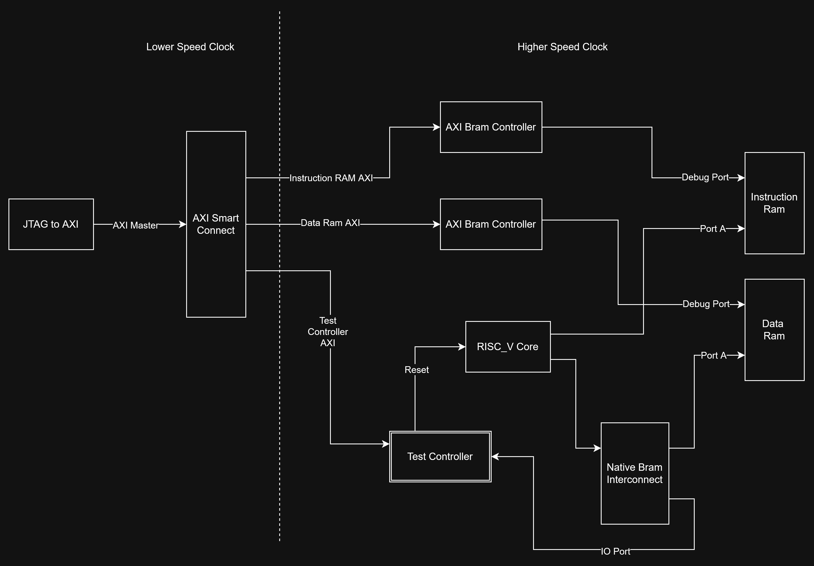

# Pipelining an RV32I RISC-V Soft Core

## A study of hazard resolution, performance, and FPGA timing tradeoffs

**Author:** Tristan Niewenhuis  
**Advisor:** Dr. Larry Pyeatt, South Dakota School of Mines and Technology  
**Project type:** Undergraduate computer architecture research  
**RTL:** VHDL  
**Platform:** Digilent Nexys A7-100T, AMD Artix-7 XC7A100T-1CSG324  
**Tools:** AMD Vivado 2026.1, GHDL, Python, and the AMD GCC 13.4.0 RISC-V toolchain  
**Date:** Fall 2026

## Overview

This repository contains a custom RV32I RISC-V processor that I converted from a non-pipelined design into a classic five-stage FPGA pipeline. The project studies a practical microarchitectural question:

> Does the reduction in cycles per instruction from data forwarding outweigh the reduction in maximum clock frequency caused by the added forwarding logic?

Rather than evaluating CPI alone, the study compares execution performance using both measured CPI and post-route maximum clock frequency:

```text
Performance = Fmax / CPI
```

The repository includes the processor RTL with three selectable hazard-resolution configurations, a single-cycle reference core, FPGA benchmark infrastructure, compiled benchmark images, and implementation outputs.

## Research Design

The same five-stage core is evaluated in three configurations. A single enumerated package constant selects the configuration, while the decoder, register file, ALU, branch unit, memories, and pipeline registers remain unchanged.

### 1. No forwarding

Read-after-write (RAW) hazards are resolved entirely with pipeline stalls.

### 2. Partial forwarding

Results are forwarded from the EX/MEM pipeline register. Hazards that require a value from MEM/WB still stall.

### 3. Full forwarding

Results are forwarded from both EX/MEM and MEM/WB. Only unavailable values, such as an immediately consumed load result, require a data-hazard stall.

This controlled structure isolates the timing, area, and CPI effects of the forwarding network from unrelated architectural changes.

## Processor Architecture

The processor implements **RV32I with the Zicsr and Zicntr extensions** using a Harvard architecture and five stages:

1. **IF - Instruction Fetch:** Selects the next PC, fetches an instruction, performs early decode, and generates the immediate.
2. **ID - Instruction Decode / Register Read:** Reads the write-first register file, detects RAW hazards, and computes registered forwarding selections.
3. **EX - Execute:** Contains the forwarding multiplexers, ALU, branch unit, target adder, CSR logic, and load/store address and byte-strobe logic.
4. **MEM - Memory:** Aligns synchronous data-memory load results.
5. **WB - Write Back:** Selects and writes the final result to the register file.

Key implementation details:

- Separate 64 KiB instruction and data memories implemented in block RAM
- Static not-taken control-flow prediction
- Branch and jump resolution in EX
- Two-cycle flush for taken branches/jumps that redirect the pipeline
- Memory-mapped test-control registers in the highest data-memory words
- Registered forwarding selections so register comparisons are not in series with EX-stage forwarding multiplexers
- A package-level `FORWARDING_AMOUNT` constant that selects `NONE`, `PARTIAL`, or `FULL`


### Partial-forwarding edge case

Partial forwarding needs additional stall control when three adjacent instructions create dependencies on two producers. A stall caused by the older producer can separate the newer producer from its consumer, making a value that was previously forwardable unavailable on the next cycle. The control logic preserves the newer producer in the correct stage, inserts a bubble, and then forwards the value with a one-cycle penalty. Senario



## Experimental Methodology

The evaluation uses the same benchmark binaries and measurement procedure for all three pipelined configurations and the single-cycle reference design.

### Hardware-in-the-loop benchmark harness

The FPGA harness includes:

- JTAG-to-AXI for loading programs and controlling tests
- AXI SmartConnect and AXI BRAM controllers
- A test controller that releases reset, detects completion, and reports verification status
- 64-bit `mcycle` and `minstret` counters
- Start and stop triggers that limit measurement to the benchmark region
- Python-generated Vivado Tcl for automated benchmark loading and execution



### Workload

- **Suite:** [Embench-IoT](https://github.com/embench/embench-iot), tag `embench-2.0rc2`
- **Programs:** 19 benchmark binaries
- **Compiler:** AMD GCC 13.4.0
- **ISA/ABI:** `rv32i_zicsr_zicntr` / `ilp32`
- **Optimization:** `-O2`, function/data sections, static linking, and garbage collection of unused sections
- **Memory layout:** `.text` in instruction memory; read-only and writable data sections in data memory

Each of the 19 binaries is run on the three pipeline configurations and the single-cycle reference core, producing **76 FPGA executions** under the same test procedure.

## Verification

The project uses three independent checks:

1. **Benchmark self-checks:** All 76 FPGA runs completed and passed the benchmark-provided verification routine.
2. **RTL simulation:** GHDL ran the same 76 images and matched the board's cycle and retired-instruction counts for every run.
3. **Independent ISA and cycle model:** A separate model reproduced the cycle and instruction counts of all **57 pipelined executions** and independently checked stall attribution.

The simulation framework classifies bubbles by source, including ALU RAW hazards, load RAW hazards, conditional-branch flushes, JAL flushes, and JALR flushes. This supports exact stall accounting without exposing the manuscript's unpublished result values.

## Metrics Collected

The study records the following for each configuration:

- Cycle count and retired-instruction count
- CPI for each benchmark and geometric-mean CPI for the suite
- Post-route Fmax
- Execution time and performance (`Fmax / CPI`)
- LUT, flip-flop, and block-RAM utilization
- Stall and flush cycles classified by cause
- Routed critical-path logic and routing delay

**Numerical performance and resource results are intentionally withheld until publication.**

## Repository Structure

```text
RISC_V.srcs/
  constrs_1/new/       constrains files for FPGA, JTAG.xdc is primary
  sources_1/new/       VHDL processor and support logic
  sources_1/bd/        Vivado block design used as the system top level
  sim_1/new/           Some rudimentary testbenches for testing AXI intraface with 
                       JTAG and observing process behavior simulating test programs 
embench-iot-files/     Compiled benchmark images used by the harness
sim_test/test_2/       Pipeline verification and debugging testbench
build_results/         Saved implementation outputs for each configuration
single_cycle/          rtl for single cycle model as comparison
RISC_V.xpr             vivado project file
run_test.py            generate run_embench.tcl to run given embench-iot tests on FPGA
```

Important RTL files in RISC_V.srcs/sources_1/new/:

- `RISC_V_TCM.vhdl` - main native-BRAM processor top level
- `RISC_V_AXI.vhdl` - AXI-interface version for external memory integration; this path remains under development
- `RISCV_package` - shared constants, types, and the forwarding-configuration selection

The principal implementation outputs are stored in the `no_neg_edge` subdirectories under `build_results/`.

## Current Scope and Limitations

- RV32I only; the M extension is not implemented
- One FPGA family, speed grade, board, compiler, and optimization level
- Static not-taken prediction rather than a dynamic branch predictor
- One implementation seed per configuration
- Performance is evaluated at each design's independently determined Fmax
- Power and energy are not measured
- The AXI memory-interface version is a work in progress and is not the primary configuration used for the controlled forwarding comparison

## Future Work

- Evaluate bimodal and gshare branch predictors
- Add a branch target buffer and return-address stack
- Evaluate earlier JAL resolution
- Compare alternative partial-forwarding networks, including MEM/WB-only forwarding
- Explore other pipeline depths and forwarding-path placements
- Complete and evaluate the external-memory AXI configuration
- Measure power and energy in addition to performance and area

## Contact

**Tristan Niewenhuis**  
[Email](mailto:Tristanniewenhuis@gmail.com) | [LinkedIn](https://www.linkedin.com/in/tristanniewenhuis/) | [GitHub](https://github.com/Tristan-Niewenhuis)
